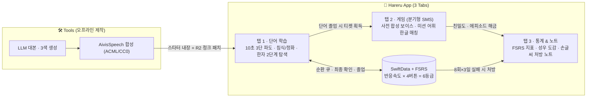

# Hareru (晴れる)

> **흐릿하던 기억이 10초 만에 선명하게 개는 일본어 단어장**  
> iOS 17+ · SwiftUI · SwiftData · AVFoundation · AivisSpeech (256kbps)

📐 **문서 바로가기**: [`Docs/Blueprint.canvas` (Obsidian 전체 구조도)](./Docs/Blueprint.canvas) · [`Docs/SPEC.md` (상세 기획·설계 명세서)](./Docs/SPEC.md) · [`Tools/` (콘텐츠 자동화 파이프라인)](./Tools/README.md)

---

## 빠른 실행 & 테스트

```bash
# 1) 코어 라이브러리 빌드 및 전체 단위 테스트 실행 (macOS CLI)
swift test

# 2) iOS 시뮬레이터 / 실기기 앱 실행 (Xcode)
open Hareru.xcodeproj
# Xcode에서 iPhone 시뮬레이터 또는 연결된 기기 선택 후 Cmd + R
```

---

## 핵심 설계 원칙

- **검증된 인출 학습**: 오늘 세션에서 틀린 단어는 침식 연출과 함께 순환하다가, 힌트 없이 자력으로 떠올리고 최종 확인 1회를 통과하면 본연의 컬러로 정화되며 졸업합니다.
- **스포일러 없는 일관된 그라데이션 UX**: 10초 3단 힌트 파도(`Δ6.0s`), 어절 박스 묶음 후리가나(표제어 발음은 정답 전 잠금), 정답 해금(`0.25s`), 실패 침식(`Red+Black`)과 졸업 정화까지 모든 상태 변화를 그라데이션으로 통일합니다.
- **성우 세계관과 분기형 SMS 미션 연결**: 단어마다 고유 3색 테마와 `256kbps` AivisSpeech(`ACML`/`CC0`) 캐릭터 음성을 입히고, 다의어는 복습 회차마다 다른 캐릭터 예문으로 순환 출제하며, 졸업 보상으로 **분기형 SMS 미션 티켓**을 획득합니다.

---

## 시스템 구조 한눈에 보기



| 모듈 | 주요 역할 | 핵심 규칙 | 상태 |
| :--- | :--- | :--- | :---: |
| **기억 엔진 (FSRS)** | 복습 주기 산출 · 세션 순환 큐 | FSRS(`S·D·R`) + 반응속도 6등급, 침식 단어 최종 확인 1회, 원시 로그 기록 | ✅ 구현 완료 |
| **탭 1 · 단어 학습** | 10초 3단 파도 카드 · 한자 2단계 탐색 | 표제어 후리가나 잠금, 어절 박스 조판, 다의어 복습 순환, 한자 팝오버/시트 | ✅ 코어 개통 |
| **탭 2 · 게임 (`Game`)** | 분기형 SMS 미션 · 미니게임 그룹 | 사전 합성 성우 보이스 응답, 미션 후보 어휘 한정 한글 발음(`칸파이`→`乾杯`) 매칭 | 📋 설계 완료 |
| **탭 3 · 통계 & 노트** | 기억 통계 · 도감 · 오프라인 처방 | 당일 8회 실패 시 수면 보류, 타 일자 3회 누적 시 손글씨 노트 처방 | 📋 설계 완료 |
| **콘텐츠 파이프라인** | 대본 · 오디오 생성 및 R2 정적 배포 | 상업 허용(`ACML`/`CC0`) 보이스 전용, Cloudflare R2 `100단어 청크` 다운로드 | 📋 설계 완료 |

---

## 폴더 구조

```text
Hareru/
├── Hareru.xcodeproj               # iOS 앱 실행 프로젝트 (시뮬레이터 · 실기기 구동)
├── Package.swift                  # Swift Package 설정 (코어 모듈 & 단위 테스트)
├── Docs/
│   ├── Blueprint.canvas           # Obsidian 아키텍처 캔버스 (전체 구조 시각화)
│   └── SPEC.md                    # 인터랙션 · FSRS 알고리즘 · 게임 · 라이선스 명세
├── Sources/Hareru/
│   ├── App/                       # 앱 진입점 (HareruApp)
│   ├── Models/                    # 도메인 · 타이밍 설정 · SwiftData 영속성 모델
│   ├── Features/
│   │   ├── Study/                 # [탭 1] 단어 덱 · 10초 3단 파도 카드 · 한자 팝오버/시트
│   │   ├── Game/                  # [탭 2] 분기형 SMS 미션 및 미니게임 그룹
│   │   └── Insights/              # [탭 3] FSRS 통계 · 캐릭터 도감 · 손글씨 처방 노트
│   ├── Components/                # 공통 UI (HintBlurModifier, SplitText, 어절 박스 후리가나 뷰)
│   ├── Services/                  # 고음질 오디오 재생(SpeechPlayer), 카탈로그, FSRS 세션 엔진
│   └── Resources/                 # 내장 스타터 오디오 및 단어·한자 JSON 데이터
├── Tests/HareruTests/             # 도메인 · FSRS 6등급 · 순환 큐 · SwiftData 단위 테스트
└── Tools/                         # 앱 외부 자동화 스크립트 (LLM 대본 · AivisSpeech 합성)
```

---

## 개발 로드맵

1. **Phase 0.5 — 탭 1 실기기 검증 (현재)**: `Hareru.xcodeproj`로 시뮬레이터·아이폰에서 10초 3단 파도 타이밍과 FSRS 순환 큐 사용성 검증 및 상수 튜닝
2. **Phase 1 — 3-Tab 코어 루프 완성**: 이자카야·일상 테마 30단어 기준 탭 2(분기형 SMS 미션) 및 탭 3(통계·성우 도감·처방 노트) 개통
3. **Phase 2 — 제작 자동화 (`Tools/`)**: LLM 대본 생성기, 3분할 번역 검증기, 맥북 AivisSpeech 배치 녹음 및 청취 검수 툴 구축
4. **Phase 3 — JLPT N5–N1 확장 & 출시 패키징**: Cloudflare R2 `100단어 청크` 프리페치, 시작 급수 온보딩, 복습 알림, `EDRDG`(`JMdict`·`KANJIDIC2`) 라이선스 고지
