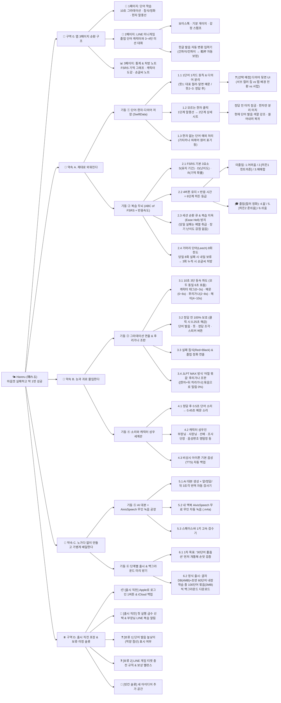

# 🌤️ Hareru (晴れる)

> **"안개(10초 블러)와 먹구름(실패 침식)이 걷히고 기억이 맑게 개다"**  
> 10초 등속 그라데이션 파도 · 캐릭터 성우 세계관(AivisSpeech) · 가상 일본인 LINE 미니게임을 결합한 iOS 일본어 단어 암기 앱

📌 **Obsidian 원본 마스터 플랜 캔버스 파일**: [`Hareru_Master_Plan.canvas`](./Hareru_Master_Plan.canvas) *(Obsidian에서 열면 전체 트리 노드를 자유롭게 편집할 수 있습니다)*

---

## 🗺️ 전체 프로젝트 마스터 플랜 트리 (한눈에 보기)



---

## 🌳 상세 계층 구조 (텍스트 트리)

```text
🌤️ Hareru (晴れる) — "마음껏 실패하고, 딱 1번 성공하면 된다"
│
├─ 📱 구역 0. 앱 전체 3페이지 순환 구조
│   ├─ 📄 1페이지 [단어 학습] : 10초 그라데이션 파도 · 침식/정화 · 한자 클릭 말풍선 ➜ 졸업 시 LINE 티켓 획득
│   ├─ 💬 2페이지 [LINE 미니게임] : 오늘 졸업한 단어의 캐릭터와 3~4마디 단기 미션 대화
│   │   ├─ 연출 : '입력 중•••' + AivisSpeech 보이스톡 + 실시간 호감도 게이지 & 감정 스탬프 + 한 줄 코치 첨삭
│   │   └─ 입력 : 한글 발음 자동 변환기 (한글 자판으로 '간파이/칸파이' 치면 '乾杯'로 찰떡 변환 · 용량 0MB)
│   └─ 📊 3페이지 [통계 & 노트] : FSRS 기억 유지율 그래프 · 캐릭터 친밀도 도감 · 거머리 단어 손글씨 처방 노트
│
├─ 🧠 약속 A. 제대로 외워진다 (데이터 & 기억 알고리즘)
│   ├─ 기둥 ① 단어·한자·다의어 저장 구조 (SwiftData)
│   │   ├─ 1.1 1단어 1카드 원칙 : 대표 뜻(뜻1)이 메인 컬러와 앞면 예문 담당 / 나머지 뜻(뜻2~4)은 정답 공개 후 표시
│   │   │   └─ ❓ [선택 예정] 다의어 뒷면 UI (후보 A: 서브 컬러 칩 / 후보 B: 탭 배경 전환 / 후보 C: 하단 서랍형)
│   │   ├─ 1.2 모르는 한자 클릭 : 1단계 말풍선(대표 뜻·음 + 현재 단어 발음 색깔 강조) → 2단계 한자 상세 시트
│   │   │   └─ 숨은 규칙 : 정답 보기 전 터치 잠금 · 한자 글자만 분리 터치 · 쓸어내려 원래 카드로 즉시 복귀
│   │   └─ 1.3 한자 없는 단어 예외 처리 : 가타카나·히라가나 단어는 외래어 원어(beer 등) 표시
│   │
│   └─ 기둥 ② 복습 두뇌 (ABC of FSRS + 반응 속도 교차 보정)
│       ├─ 2.1 FSRS 기본 3요소 : S(기억 유지 기간) · D(단어 난이도) · R(현재 기억 확률)
│       ├─ 2.2 4버튼 유지 × 정밀 반응 시간 = 6단계 히든 등급 판정
│       │   ├─ [미졸업 · 재확인] 1. 어려움(모름) / 2. [히든1: 6~10초 힌트의존] / 3. 애매함
│       │   └─ [🎓 즉시 졸업 · 컬러 정화] 4. 앎(졸업 기준선) / 5. [히든2: 준-쉬움] / 6. 쉬움
│       ├─ 2.3 세션 순환 큐 & 복습 지옥(Ease Hell) 방지 : 당일 실패는 '예열'로 취급해 장기 난이도 감점 없음
│       └─ 2.4 거머리 단어(Leech) 8회 차단기 : 당일 8회 실패 시 내일로 보류 → 다른 날 3회 누적 시 손글씨 노트 처방
│
├─ 🎨 약속 B. 눈과 귀로 몰입한다 (그라데이션 & 성우 세계관)
│   ├─ 기둥 ③ 그라데이션 연출 & 후리가나 조판 (SwiftUI)
│   │   ├─ 3.1 10초 3단 등속 파도 (모두 동일하게 6.0초 동안 선명화)
│   │   │   └─ 0초 단어 본체 → 0~3초 캐릭터 태그 → 0~6초 일문 예문 → 2~8초 예문 후리가나 → 4~10초 한글 문맥
│   │   ├─ 3.2 정답 전 100% 보호 (정답 보기 시 0.25초 그라데이션 해금) : 단어 발음 · 뜻 · 정답 조각 · 스피커 버튼
│   │   ├─ 3.3 실패 침식 & 정화 : 실패 시 칠흑+딥크림슨(Red+Black) 침식 → '앎' 이상 졸업 시 본래 컬러로 정화
│   │   └─ 3.4 JLPT MAX식 '어절 묶음' 후리가나 : [한자+뒤따르는 히라가나]를 한 박스로 묶어 긴 후리가나 밀림 0%
│   │
│   └─ 기둥 ④ 소리와 캐릭터 성우 세계관 (AVFoundation)
│       ├─ 4.1 재생 순서 : 정답 보기 → 0.5초 후 단어 음성 → 0.45초 간격 → 예문 음성 (카드 넘기면 즉시 취소)
│       ├─ 4.2 성우 라인업 : 부장님 · 라멘집 사장님 · 알바생 · 선배 · 할머니 · 조사단장 · 음성변조 명탐정 등
│       └─ 4.3 비상시 백업 : 음성 파일이 없을 때는 아이폰 기본 일본어 TTS가 캐릭터 피치·속도로 자동 대독
│
├─ 🤖 약속 C. 노가다 없이 만들고 가볍게 배달한다 (생산 & 배포)
│   ├─ 기둥 ⑤ AI 대본 + AivisSpeech 맥북 무인 녹음 공장
│   │   ├─ 5.1 AI 대본 생성 + 앞/정답/뒤 3조각 번역 불량 자동 검사기
│   │   ├─ 5.2 내 맥북 AivisSpeech 무료 무인 자동 녹음 (.m4a 경량 압축 · 단어당 약 30KB)
│   │   └─ 5.3 스페이스바 1키 초고속 검수기 (어색한 억양만 R 키로 재녹음 지시)
│   │
│   └─ 기둥 ⑥ 단계별 출시 & 백그라운드 미리 받기
│       ├─ 6.1 1차 목표 : '이자카야·라멘집 30단어'로 1~3페이지 풀옵션 먼저 개통해 손맛 완성
│       └─ 6.2 정식 출시 : 전체 글자·한자 DB(4MB) + 초반 60단어 내장 / 선택 급수 100단어(3MB)씩 몰래 다운로드
│
└─ ⏸️ 구역 D. 출시 직전 포장 & 보류·미정 슬롯
    ├─ 📦 [출시 직전] 로그인 : 개발 중엔 무로그인 자동 저장 → 출시 직전 'Apple로 로그인' 버튼 1개 추가
    ├─ 🔔 [출시 직전] 온보딩 & 알림 : 시작 급수(N5~N1) 선택 + 부장님 LINE 스타일 복습 푸시 알림
    ├─ ❓ [보류 · 미정 1] 단어 발음 높낮이(억양 점선 그래프) 표시 여부
    ├─ ❓ [보류 · 미정 2] LINE 미니게임 티켓 충전 기준(예: 5단어 졸업 = 1티켓) 및 호감도 보상 밸런스
    └─ 📝 [빈칸 슬롯] 새로운 아이디어가 떠오를 때마다 자유롭게 채워 넣는 예비 공간
```

---

## 📁 프로젝트 폴더 구조

```text
Hareru/
├── README.md                        # 전체 마스터 플랜 트리 & 프로젝트 안내소 (본 문서)
├── Hareru_Master_Plan.canvas        # Obsidian Canvas 원본 트리 파일 (자유 편집용)
├── HANDOVER_ANTIGRAVITY.md          # 상세 기술·인터랙션 명세서
├── Package.swift                    # Swift Package 매니페스트 (iOS 17+, macOS 14+)
├── App/
│   └── BocaSampleApp.swift          # @main 앱 진입점
├── Models/
│   ├── Word.swift                   # 단어 도메인 모델
│   ├── Word+Samples.swift           # 샘플 단어 데이터 (beer, ramen)
│   └── VoiceProfile.swift           # 캐릭터 성우 프로필
├── Services/
│   └── SpeechPlayer.swift           # 로컬 오디오 재생 + iOS TTS 자동 폴백
├── Views/
│   ├── WordDeckView.swift           # 상단 카테고리, 진행도 게이지, 카드 덱 뷰
│   ├── WordCardView.swift           # 10초 그라데이션 시퀀스 및 카드 본체 뷰
│   └── Components/
│       ├── SplitText.swift          # "앞 / 정답 / 뒤" 분할 번역 컴포넌트
│       └── HintBlurModifier.swift   # 그라데이션 블러 및 투명도 제어 모디파이어
└── Resources/
    ├── Audio/                       # 캐릭터 음성 리소스
    └── Data/
        └── words.json               # 단어 메타데이터 JSON
```
