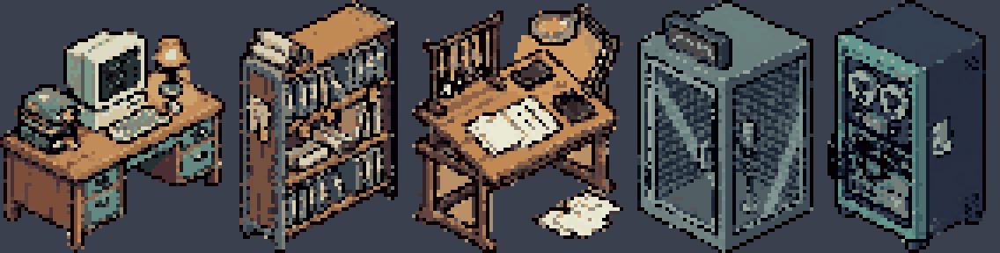
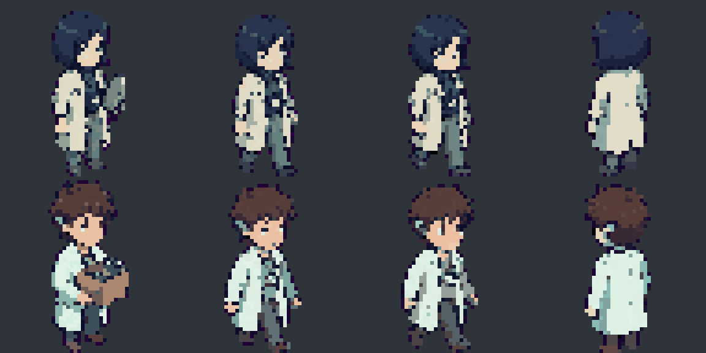
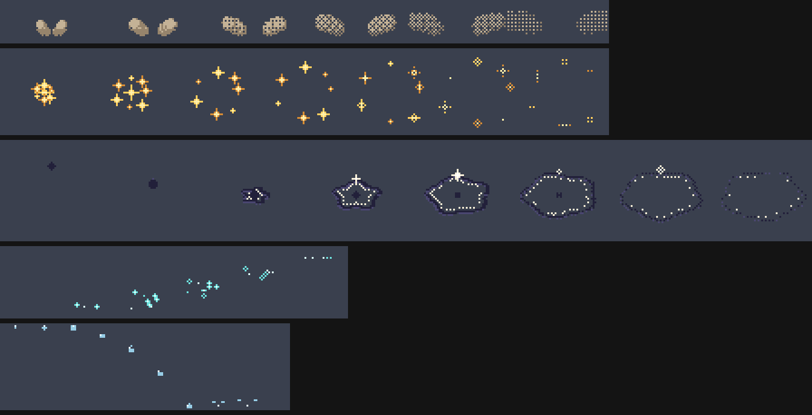

<div align="center">

# 晴れる · Hareru

**흐릿하던 기억이 맑게 개는 일본어 단어장 — 그리고, 그 기억으로 짓는 작은 연구소.**

`iOS 17+` · `SwiftUI` · `SpriteKit` · `FSRS` · `Liquid Glass` · `Pixel Art`



</div>

---

## 한 문장으로

> 단어를 외울수록 하늘이 개고, 하늘이 갤수록 연구소가 자란다.

Hareru는 **과학적인 복습 알고리즘(FSRS)** 으로 JLPT 단어를 외우는 앱입니다.
화면 뒤에는 지금 이 순간의 **날씨와 시간대**가 흐르고, 탭 하나만 넘기면 내가 외운 한자들이 **픽셀 아트 연구소**를 복원합니다.

---

## 하루의 빛깔

앱의 배경은 장식이 아니라 시계입니다. 시간대마다 하늘의 색 온도가 달라지고, 그 색에서 유리·버튼·글자 색이 파생됩니다.

| | 시간대 | 시각 | 분위기 |
| :-: | :-- | :-- | :-- |
| 🌅 | **새벽** (dawn) | 05:00 – 07:59 | 옅은 보랏빛에서 살구빛으로 번지는 이른 아침 |
| ☀️ | **아침** (morning) | 08:00 – 11:59 | 맑고 차가운 하늘, 선명한 대비 |
| 🌤 | **낮** (midday) | 12:00 – 16:59 | 가장 높은 채도와 짧은 그림자 |
| 🌇 | **노을** (sunset) | 17:00 – 19:29 | 황금빛에서 장밋빛으로 기우는 저녁 |
| 🌙 | **밤** (night) | 19:30 – 04:59 | 깊은 남색, 별과 달 |

여기에 **22가지 날씨**가 겹칩니다.
맑음 · 구름 · 흐림 · 이슬비 · 비 · 뇌우 · 태풍 · 진눈깨비 · 우박 · 눈 · 눈보라 · 박무 · 안개 · 황사 · 폭염 · 강풍 · 무지개 · 오로라 · 유성우 · 벚꽃 · 단풍 …
5개 시간대 × 22개 날씨, 위치와 날짜를 시드로 한 추정 날씨가 `WeatherSkyCanvasView`에서 60fps로 그려집니다.

**색은 OKLCH로 설계합니다.** 하늘 팔레트(`WeatherSkyPalette`)에서 명도·채도를 뽑아 유리 색조와 통계 색을 파생하므로, 어떤 날씨와 시간대에서도 색이 서로 어긋나지 않습니다. 시스템은 하늘의 밝기에 맞춰 라이트/다크를 스스로 고릅니다.

> 🚧 지금 날씨 배경의 렌더링 품질을 높이고 종류를 더 늘리는 작업이 진행 중입니다. 실제 기상 API(WeatherKit) 연동 여부도 함께 결정합니다.

---

## 학습: 10초 안에 떠올리기

<table>
<tr><td width="50%">

**FSRS + 반응 시간 = 6등급**

- 카드 앞면의 예문이 **10초에 걸쳐 서서히 선명**해집니다 (스포일러 없는 3단 힌트).
- 사용자는 4개 버튼만 누릅니다. 알고리즘은 반응 시간을 읽어 **6단계 히든 등급**으로 바꿉니다.
  - 6초 안에 답을 확인 → 표제어만으로 떠올린 정상 등급
  - 6~10초 → 예문의 도움을 받은 것으로 보고 재출제
- 틀린 단어는 오늘 세션 안에서 순환하다가, 힌트 없이 떠올리고 최종 확인을 통과하면 졸업합니다.

</td><td width="50%">

**읽기 좋은 카드**

- 표제어 위에 **한자마다 후리가나**를 올립니다 (`TermRuby`, 숙자훈은 묶음 처리).
- 예문은 명조체, 후리가나는 고딕체.
- 한자를 누르면 2단계 탐색(팝오버 → 시트)으로 음독·훈독·부수를 확인.
- 정답 보기와 4개 평가 버튼은 **같은 Liquid Glass**, 같은 색. 어떤 버튼도 나쁜 느낌을 주지 않도록.
- 세션을 끝내면 맑아지는 축하 연출.

</td></tr>
</table>

**데이터**: JLPT N5 **단어 약 710개 · 한자 약 450자** 한국어 뜻과 예문(임시). 출처는 JMdict · KANJIDIC2 · JmdictFurigana · open-anki-jlpt-decks이며, 라이선스는 [`Docs/DATA_PIPELINE.md`](Docs/DATA_PIPELINE.md)에 정리했습니다.

---

## 연구소: 외운 만큼 자라는 픽셀 세계

> **2XXX년, 일본어가 사라져 가는 세계.** 국립언어유산연구소(国立言語遺産研究所, **NJL**)에는 연구원이 단 두 명 남았습니다.
> 단어를 외워 얻은 **연구 포인트**로 사라진 한자를 복원하고, 사무실을 키우고, 도시의 하늘을 다시 맑게 되돌리는 경영 시뮬레이션입니다.

<div align="center">

<br><sub>주임 연구원(위)과 신입 연구원, 나(아래) — 48×48, 4방향(남동·남서·북동·북서)</sub>
</div>

### 학습이 곧 경영

| 학습 | → | 연구소 |
| :-- | :-: | :-- |
| 새 단어를 외움 | → | **연구 포인트** +10 |
| 복습 성공 (안정도가 높을수록, 간격이 길수록, 쉬울수록) | → | 연구 포인트 +6 ~ +18 |
| 하루 첫 접속 | → | **예산**(予算) 정산 — 영향력이 높을수록 늘어남 |
| 포인트로 한자 복원 | → | **영향력** 상승 → 연구소 하늘이 *비 → 흐림 → 맑음* |
| 내가 외운 음독·훈독·단어 수 | → | 복원 연출의 말풍선(`+音` `+訓` `+形` `+文`) |

복원 비용은 정해져 있고 결과는 즉시 저장됩니다. 연출은 보여 주기만 하므로 도중에 앱을 닫아도 진행은 사라지지 않습니다.

### 시설과 콤보

| 시설 | 효과 |
| :-- | :-- |
| **연구원 · 신입 책상** | 시작 시설. 1인 1책상, 옮길 수는 있어도 철거할 수 없음 |
| **한자 서고** | 연구 포인트 +5% |
| **필사실** | 복원 비용 −10% |
| **녹음 부스** | 연구 포인트 +5% |
| **서버 랙** | 연구 포인트 +10% |

서로 **맞닿게 배치**하면 콤보가 발동합니다.

- **写本工房**: 한자 서고 + 필사실 → 복원 비용 −20%
- **音声アーカイブ**: 녹음 부스 + 서버 랙 → 연구 포인트 +15%
- **研究デスク**: 연구원 책상 + 한자 서고 → 연구 포인트 +10%

---

## 에셋 갤러리

모든 그림은 픽셀 단위로 직접 다듬고, 코드로 후처리합니다. 원본·제작 스크립트·확대 미리보기는 [`Docs/Art/`](Docs/Art)에 있고, 앱이 쓰는 사본은 `Sources/Hareru/Resources/Art/`에 있습니다.

<table>
<tr>
<td align="center" width="50%">
<br>
<b>KURO</b> · 구형 언어 기록 안드로이드<br><sub>외눈 센서 렌즈가 호박색 포인트</sub>
</td>
<td align="center" width="50%">
<br>
<b>NJL 방송 AI</b> · 도시 기상 AI<br><sub>파형 모니터가 얼굴</sub>
</td>
</tr>
<tr>
<td align="center">
<br>
<b>白石 ツル</b> · 최고령 기증자<br><sub>비녀 칸자시</sub>
</td>
<td align="center">
<br>
<b>ジン</b> · 간판 복원 장인<br><sub>네온 한자 프레임</sub>
</td>
</tr>
</table>

<div align="center">

<br><sub>이펙트 — 착지 먼지 · 복원 완료 먹 번짐 · 콤보 반짝임 · 양동이 위 누수 · 정산 청록 입자 (동작 줄이기에서는 모두 꺼짐)</sub>
<br><br>

<br><sub>픽셀 UI 프레임 (1px = 2pt) · 16/24px 아이콘 세트</sub>
</div>

| 분류 | 내용 | 위치 |
| :-- | :-- | :-- |
| 인물 | 주임 · 신입 연구원 + 출연진 9인 (idle · walk · 앞/뒤) | `Art/Characters` |
| 환경 | 시설 5종, 소품, 마루·벽·창문 타일, 확장 모듈, 거리 간판 | `Art/Environment` |
| 이펙트 | 먼지 · 먹 · 반짝임 · 누수 · 입자 | `Art/Effects` |
| UI | 프레임 4종, 아이콘 16/24px | `Art/UI` |

---

## 시작하기

```bash
# 코어 라이브러리 빌드와 단위 테스트
swift test

# Mac 프리뷰 (시뮬레이터 없이 바로 실행)
swift run HareruPreview

# iOS 시뮬레이터 · 실기기
open Hareru.xcodeproj   # 기기를 고르고 Cmd + R
```

탭은 **학습 · 연구소 · 통계 · 설정** 네 개입니다. 학습 탭은 항상 살아 있고, 나머지는 열 때 올라옵니다.

---

## 구조

```text
Hareru/
├── Sources/Hareru/
│   ├── Models/             # 단어 · 한자 · 목소리 · 연구소 상태 (Institute/)
│   ├── Services/
│   │   ├── SRS/            # FSRS와 반응 시간 등급, 세션 엔진
│   │   ├── Weather/        # 시간대 · 22가지 날씨 · 하늘 팔레트
│   │   └── Institute/      # 보상 계산 · 경영 엔진 · 사무실 시뮬레이션
│   ├── Features/
│   │   ├── Study/          # 카드 · 덱 · 한자 탐색
│   │   ├── GameChapter/    # 연구소 화면 · SpriteKit 사무실 · 픽셀 프레임/아이콘
│   │   ├── Insights/       # JLPT 목표와 통계
│   │   └── Settings/
│   └── Resources/          # 데이터 JSON · 아트 · 오디오
├── Tests/HareruTests/      # FSRS · 루비 · OKLCH · 연구소 · 사무실 시뮬레이션
├── Tools/                  # N5 데이터 파이프라인 (JMdict / KANJIDIC2 → 앱 JSON)
└── Docs/
    ├── GAME_DESIGN.md      # 세계관 · 경제 · 엔딩 · 기술 설계
    ├── DATA_PIPELINE.md    # 데이터 출처와 라이선스
    ├── BACKLOG.md          # 보류 작업
    └── Art/                # 에셋 원본 · 제작 스크립트 · 미리보기
```

---

## 앞으로

이 앱이 중요하게 여기는 여섯 가지가 우선순위의 기준입니다.

1. 암기 알고리즘의 과학성 (FSRS + 반응 시간)
2. 실시간 위치 날씨와 시간대 애니메이션의 품격
3. 색 조화 이론에 근거한 배색
4. 단어별 캐릭터 음성과 예문 데이터의 규모
5. 단어 · 통계 · 날씨 · 캐릭터가 하나로 엮인 게임
6. JLPT 목표와 통계 시각화

### 지금 가는 길

- [ ] **프리미엄 날씨**: 구름 볼륨, 빗방울 굴절, 시간대별 빛 산란, 새 날씨 종류, 실제 기상 데이터 연동
- [ ] **픽셀 하늘**: 연구소 창밖의 하늘을 픽셀 그래픽 날씨로 (에셋 수령 후)
- [ ] **복원한 한자가 도시 간판으로**: 복원한 한자가 거리의 네온 간판에 켜지는 시각화
- [ ] **출연진 등장**: 급수 단계에 따라 KURO · 겐 · 미오(1단계) → 츠루 · 진(2~3단계) → 레이나 · 렌(4~5단계)이 방문
- [ ] **N4 승급**: 2단계 연구소의 승급 조건과 확장 모듈
- [ ] **캐릭터 음성**: 단어별 담당 인물 배정 → 예문을 인물 말투로 다시 쓰기 → 음성 합성
- [ ] **N4~N1 데이터**: 한국어 뜻과 예문 확장, 엔딩(N1 합격 자기 보고)까지
- [ ] **카테고리 카드 색**: OKLCH에서 색상각만 고정하고 명도·채도는 하늘에서 파생
- [ ] **기념일 배경**: 크리스마스, 추석(음력) 같은 날의 전용 하늘

자세한 보류 사유와 연결 지점은 [`Docs/BACKLOG.md`](Docs/BACKLOG.md), 세계관과 시스템 설계는 [`Docs/GAME_DESIGN.md`](Docs/GAME_DESIGN.md)에 있습니다.

---

## 라이선스와 출처

단어·한자 데이터는 EDRDG(JMdict · KANJIDIC2)와 JmdictFurigana(CC BY-SA 4.0), open-anki-jlpt-decks(MIT)를 바탕으로 합니다. 자세한 고지는 [`Docs/DATA_PIPELINE.md`](Docs/DATA_PIPELINE.md)를 참고하세요.

<div align="center"><sub>晴れる — 하늘이 개는 만큼, 기억도 맑아지길.</sub></div>
