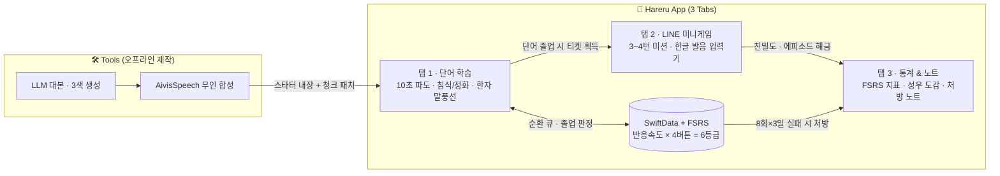

# Hareru (晴れる)

> **흐릿하던 기억이 10초 만에 선명하게 개는 일본어 단어장**  
> iOS 17+ · SwiftUI · SwiftData · AVFoundation · AivisSpeech

📐 **문서 바로가기**: [`Docs/Blueprint.canvas` (Obsidian 전체 구조도)](./Docs/Blueprint.canvas) · [`Docs/SPEC.md` (상세 기획·설계 명세서)](./Docs/SPEC.md) · [`Tools/` (콘텐츠 자동화 파이프라인)](./Tools/README.md)

---

## 핵심 설계 원칙

- **실패 친화적 인출 학습**: 오늘 세션에서 몇 번을 틀려도 장기 난이도 감점 없이 순환하다가, 힌트 없이 **단 한 번 자력으로 떠올리면 즉시 졸업**합니다.
- **일관된 그라데이션 UX**: 10초 3단 힌트 파도(`Δ6.0s`), 정답 해금(`0.25s`), 실패 누적 시 컬러 침식(`Red+Black`)과 졸업 시 컬러 정화까지 모든 상태 변화를 그라데이션으로 통일합니다.
- **성우 세계관과 실전 회화 연결**: 단어마다 고유 3색 테마와 AivisSpeech 캐릭터 음성을 입히고, 졸업한 단어의 캐릭터와 **LINE 미션 미니게임**으로 즉시 써먹습니다.

---

## 시스템 구조 한눈에 보기



| 모듈 | 주요 역할 | 핵심 규칙 | 상태 |
| :--- | :--- | :--- | :---: |
| **탭 1 · 단어 학습** | 10초 그라데이션 카드 · 한자 탐색 | 발음·뜻·스피커는 정답 전 잠금, 어절 묶음 후리가나로 글자 밀림 방지 | 🚧 진행 중 |
| **탭 2 · LINE 게임** | 캐릭터 미션 대화 · 한글 발음 변환 | 3~4턴 단기 스테이지로 토큰 비용 통제, 한글 자판(`칸파이`→`乾杯`) 지원 | 📋 설계 완료 |
| **탭 3 · 통계 & 노트** | 기억 통계 · 도감 · 오프라인 처방 | 당일 8회 실패 시 수면 보류, 타 일자 3회 누적 시 손글씨 노트 처방 | 📋 설계 완료 |
| **기억 엔진 (FSRS)** | 복습 주기 산출 · 세션 순환 큐 | FSRS(`S·D·R`) 기반 + 클릭 반응속도로 6단계 히든 등급 보정 (`앎` 이상 졸업) | 📋 설계 완료 |
| **콘텐츠 파이프라인** | 대본 · 오디오 자동 생성 및 배포 | `앞/정답/뒤` 3분할 번역 자동 검증, `.m4a` 경량화 및 100단어 청크 다운로드 | 📋 설계 완료 |

---

## 폴더 구조

```text
Hareru/
├── Package.swift                  # Swift Package 설정 (Xcode에서 바로 열기 지원)
├── Docs/
│   ├── Blueprint.canvas           # Obsidian 아키텍처 캔버스 (전체 구조 시각화)
│   └── SPEC.md                    # 인터랙션 · FSRS 알고리즘 · 데이터 스키마 명세
├── Sources/Hareru/
│   ├── App/                       # 앱 진입점 (HareruApp)
│   ├── Models/                    # 도메인 및 SwiftData 모델 (Word, VoiceProfile 등)
│   ├── Features/
│   │   ├── Study/                 # [탭 1] 단어 덱 · 10초 그라데이션 카드 · 한자 팝오버
│   │   ├── LineChat/              # [탭 2] 가상 일본인 LINE 미션 미니게임
│   │   └── Insights/              # [탭 3] FSRS 통계 · 캐릭터 도감 · 손글씨 처방 노트
│   ├── Components/                # 공통 UI (HintBlurModifier, SplitText, 후리가나 뷰)
│   ├── Services/                  # 오디오 재생(SpeechPlayer), FSRS, 한글→일문 변환기
│   └── Resources/                 # 내장 스타터 오디오 및 단어 JSON 데이터
└── Tools/                         # 앱 외부 자동화 스크립트 (LLM 대본 · AivisSpeech 합성)
```

---

## 개발 로드맵

1. **Phase 1 — 30단어 코어 개통**: 이자카야·라멘집 테마 30단어로 탭 1~3 전체 루프를 먼저 완성하고 실기기 사용성 검증
2. **Phase 2 — 제작 자동화 (`Tools/`)**: LLM 대본 생성기, 3분할 번역 검증기, 맥북 AivisSpeech 로컬 배치 녹음 및 고속 검수 툴 구축
3. **Phase 3 — JLPT N5~N1 확장**: 급수별 데이터 순차 생성 및 100단어 청크 백그라운드 프리페치 연동
4. **Phase 4 — 출시 패키징**: 시작 급수 온보딩, 복습 푸시 알림, Apple 로그인, 오픈소스 사전(`JMdict`·`KANJIDIC2`) 라이선스 고지
