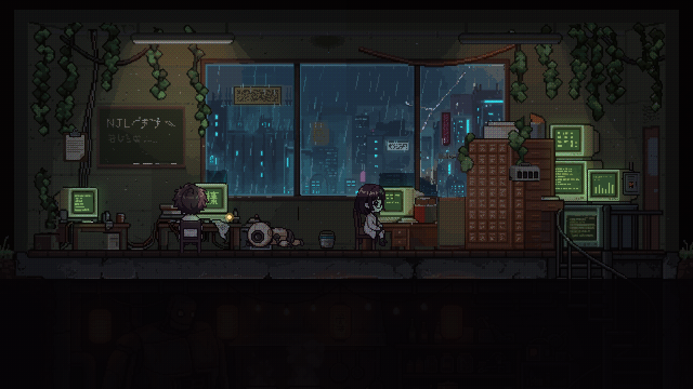
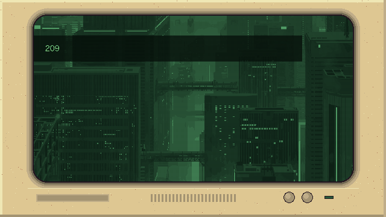
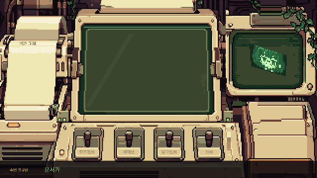
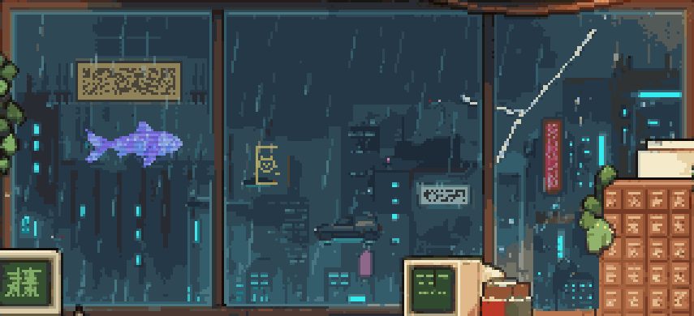
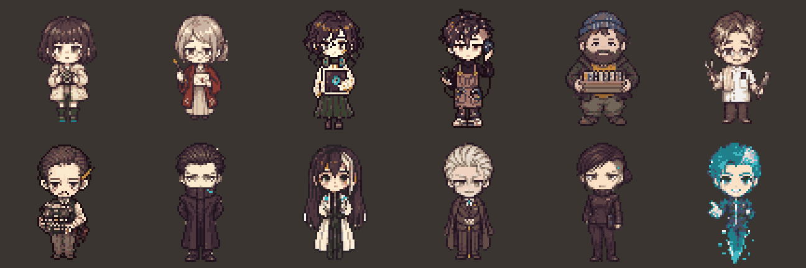

<div align="center">

# 晴れる · Hareru

**잊힌 일본어를 한 단어씩 되찾는, 2094년의 작은 연구소.**

`Godot 4.7` · `GDScript` · `FSRS` · `Pixel Art` · `JLPT N5 → N1`



</div>

---

## 한 문장으로

> 단어를 외울수록 사람들이 다시 말을 하고, 연구소에 볕이 든다.

Hareru는 **과학적인 복습 알고리즘(FSRS)** 위에 **픽셀 아트 연구소 이야기**를 얹은 JLPT 단어 학습 게임입니다. 지금은 SwiftUI 앱에서 **Godot으로 옮기는 중**이고, 첫 목표는 Day 1 하루를 최종 품질로 만드는 것입니다.

---

## 세계

2079년, 신경망 기업 **NeuroLex**가 뇌파 통신 칩을 퍼뜨린 「바벨 패치」 이후 사람들은 말 대신 칩으로 통신하고, 거리의 간판과 문서는 기하학적 점무늬 코드 **렉스코드(LexCode)** 로 바뀌었습니다. 15년 뒤인 2094년, 육성 일본어와 한자는 거의 잊혔습니다.

주인공은 NeuroLex에서 잘린 뒤 **국립언어유산연구소(国立言語遺産研究所, NJL)** 에 출근합니다. 연구원은 한자를 다 아는 마지막 사람인 **주임 연구원** 한 명, 예산은 끊긴 지 오래입니다.

- 세계관 · 인물 · 스토리 원본: [`Docs/01_World`](Docs/README.md) · [`CHARACTERS.md`](Docs/02_Characters/CHARACTERS.md) · [`MAIN_PLOT.md`](Docs/03_Story/MAIN_PLOT.md)
- 1막(N5) 대본: [`N5_SCRIPT.md`](Docs/03_Story/Acts/N5/N5_SCRIPT.md)

---

## 하루의 흐름

```
출근 → 대화 → 판독 → 퇴근
```

| 단계 | 하는 일 |
| :-- | :-- |
| **출근** | 연구소 단면 화면. 밝기 · 창밖 날씨 · 인물이 그날의 진행을 보여 줌 |
| **대화** | 인물이 일본어로 말하고, 주인공의 칩이 뜻을 풀어 줌 |
| **판독** | 정면 판독기에 종이가 말려 올라오고, 한 장에 단어의 뜻 하나. 스캔 뒤 아래 스위치 4개로 평가 (FSRS). 옆의 판독 기록지에 남음 |
| **퇴근** | 오늘 되찾은 단어 · 기록 정리. 새벽 4시가 지나면 다음 날 |

**말 잃기:** 오래 복습하지 않아 잊은 단어는 인물도 그 단어를 말하지 못합니다. 외운 만큼 대화가 선명해지고, 잊은 만큼 흐려집니다. 설계는 [`Docs/04_Design/`](Docs/04_Design/README.md)에 있습니다.

---

## 움직이는 장면

<table>
<tr>
<td align="center" width="50%">
<br>
<b>인트로</b> · 부팅 → 2094년의 도시 → 연구소
</td>
<td align="center" width="50%">
<br>
<b>판독</b> · 종이 한 장에 뜻 하나, 기록지에 쌓임
</td>
</tr>
<tr>
<td align="center">
<br>
<b>창밖</b> · 비 · 번개 · 홀로그램 물고기 · 렉스코드 간판
</td>
<td align="center">
<br>
<b>초기 콘셉트</b> · 크림색 PC + 초록 인광 + 담쟁이
</td>
</tr>
</table>

게임 화면은 Godot에서 직접 녹화했습니다 (640×360 원본 크기). 그 밖의 원본 · 제작 스크립트는 [`Docs/05_Art/`](Docs/05_Art/README.md)에 있습니다.

---

## 사람들

<div align="center">

<br><sub>새 조연 후보 (선발 12) — 옛 동네 · 매체별 가게 사람들 7명과 NeuroLex 사람들 5명. 아직 게임에 넣기 전 (68×68, 정면)</sub>
</div>

인물 설정의 원본은 [`CHARACTERS.md`](Docs/02_Characters/CHARACTERS.md), 선발 기록은 [`SELECTION.md`](Docs/05_Art/Cast/free_cast_2026-11-07/SELECTION.md)에 있습니다.

---

## 학습

- **FSRS + 반응 시간:** 버튼은 4개지만, 반응 시간을 함께 읽어 실제 기억 상태를 더 세밀하게 판단합니다.
- 틀린 단어는 그날 안에서 다시 나오고, 힌트 없이 떠올리면 졸업합니다. 하루 새 단어 상한이 있어 넘치면 다음 날로 미룹니다.
- **데이터:** JLPT N5 단어 약 710개 · 한자 약 450자의 한국어 뜻과 예문. N4~N1은 순서대로 늘립니다.
- **목소리:** 단어와 대사는 게임 인물의 목소리로 읽습니다. 인물을 만나야 그 목소리가 열립니다.

---

## 실행

```bash
# 게임 (Day 1을 처음부터)
godot --path Game

# 창 없는 자동 테스트 (0 = 통과)
godot --headless --path Game -s res://tests/run_tests.gd

# Day 1을 실제 화면으로 끝까지 자동 진행
godot --headless --path Game -- --autoplay
```

그림을 바꾼 뒤에는 `python3 Game/tools/sync_art.py` → `godot --headless --path Game --import`. 실행 인자 전체는 [`Game/README.md`](Game/README.md)에 있습니다.

---

## 구조

```text
Hareru/
├── Game/                 # Godot 프로젝트 — 지금 만드는 게임
│   ├── scripts/          # flow(상태 머신) · srs(FSRS) · save · story · audio · ui
│   ├── scenes/           # intro · lab · dialog · reader · leave
│   ├── art/ · audio/     # 확정 에셋 사본
│   ├── data/             # Tools가 내보낸 단어 · 대사
│   └── tests/            # 창 없는 테스트
├── Docs/                 # 기획 문서 — 목차는 Docs/README.md
│   ├── 00_Project/       # 로드맵 · 백로그 · 결정 기록 · 용어집
│   ├── 01_World/         # 연대기 · 언어 · NeuroLex · NJL · 장소
│   ├── 02_Characters/    # 인물 (CHARACTERS.md 한 파일)
│   ├── 03_Story/         # 큰 줄기 · 반전 · 집필 규칙 · 막별 대본
│   ├── 04_Design/        # 하루 흐름 · 말 잃기 · 진행 · 이벤트 · 화면 시안
│   ├── 05_Art/           # 아트 기준표 · 에셋 원본
│   ├── 06_Voice/         # 음성 배정 규칙
│   ├── 07_Data/          # 단어 데이터 파이프라인 · 라이선스
│   ├── 08_Study/         # 공부 기록
│   └── Archive/          # 대체된 옛 문서
├── Tools/                # 단어 · 대사 · 음성 파이프라인 (JMdict / KANJIDIC2 → 게임 JSON)
├── Sources/ · Tests/     # 예전 SwiftUI 앱 (기능 동결)
└── CLAUDE.md             # 작업 규칙
```

---

## 앞으로

이 게임이 중요하게 여기는 여섯 가지 기준.

1. 과학적인 암기 알고리즘 (FSRS + 반응 시간)
2. 날씨와 시간대를 반영한 배경과 연출
3. 색 조화 이론에 근거한 배색
4. 게임 인물의 목소리로 듣는 단어 · 예문
5. 단어 · 통계 · 날씨 · 이야기의 유기적 조화
6. JLPT 목표를 위한 개인화 통계

진행 단계 ([로드맵](Docs/00_Project/ROADMAP.md)):

```
P0 스파이크 ✅ → P1 설계 고정 → P2 버티컬 슬라이스 (Day 1) ← 지금 → P3 제작 → P4 다듬기 · 출시
```

지금 안 하는 일과 그 이유는 [`Docs/00_Project/BACKLOG.md`](Docs/00_Project/BACKLOG.md)에 있습니다.

<details>
<summary>예전 SwiftUI 앱 실행 (기능 동결)</summary>

```bash
swift test               # 코어 라이브러리 단위 테스트
swift run HareruPreview  # Mac 프리뷰
open Hareru.xcodeproj    # iOS 시뮬레이터 · 실기기
```

</details>

---

## 라이선스와 출처

단어·한자 데이터는 EDRDG(JMdict · KANJIDIC2)와 JmdictFurigana(CC BY-SA 4.0), open-anki-jlpt-decks(MIT)를 바탕으로 합니다. 자세한 고지는 [`Docs/07_Data/DATA_PIPELINE.md`](Docs/07_Data/DATA_PIPELINE.md)를 참고하세요.

<div align="center"><sub>晴れる — 하늘이 개는 만큼, 기억도 맑아지길.</sub></div>
